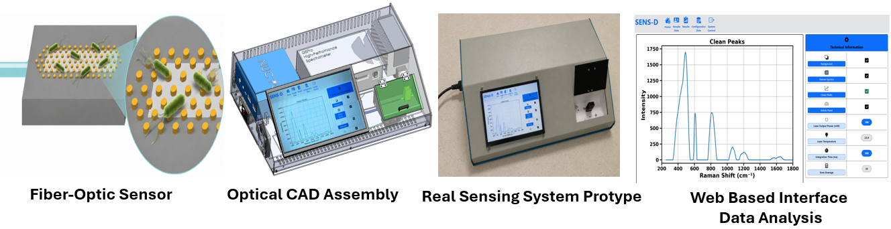
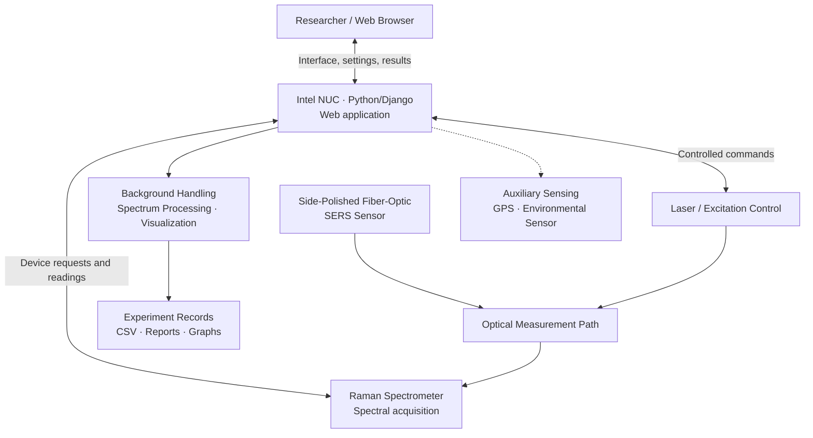

<h1 align="center">Compact Fiber-Optic SERS Platform</h1>

  <strong>Fiber-Optic Biosensing · Raman Spectroscopy · Scientific Instrumentation · Embedded Control · Full-Stack Software</strong>

  A compact research instrument integrating a fiber-optic SERS sensor, optical excitation, Raman spectral acquisition,
  custom mechanical design, and browser-based experiment control.

  <a href="https://github.com/Kamran00786">Engineering Portfolio</a> ·
  <a href="https://scholar.google.com/citations?user=VaxZYvwAAAAJ&hl=en">Google Scholar</a> ·
  <a href="https://www.linkedin.com/in/kamran-bashir-taas-b2333a212/">LinkedIn</a>

> **Public engineering showcase — source code not included.** This repository describes an integrated research instrument and selected engineering contributions. Complete application source, proprietary hardware interfaces, unpublished measurements, and design files are not publicly distributed.

## Project Overview

The **Compact Fiber-Optic SERS Platform** is a research-oriented instrumentation system built around **surface-enhanced Raman scattering (SERS)** on a side-polished optical fiber. It brings sensor fabrication, mechanical design, optical and electronic hardware, a Raman spectrometer, and a Python/Django web application together in one experimental workflow.

The work spans both physical instrument development and software engineering: from optical and mechanical arrangement to device interfacing, spectral processing, results visualization, and experiment reporting.

## System Overview — From Fiber-Optic Sensor to Spectral Analysis

*Figure 1. Overview of the Compact Fiber-Optic SERS Platform, showing the fiber-optic sensor, optical CAD assembly, assembled sensing-system prototype, and web-based Raman spectral data analysis.*

## From Sensor Development to Instrumentation

| Stage | Engineering contribution |
| --- | --- |
| **1. Sensor concept & fabrication** | Developed a side-polished multimode-fiber SERS sensing approach, including microsphere-patterned structures and sensor preparation. |
| **2. Optical design & integration** | Integrated optical excitation, fiber-optic interfaces, and spectrometer-based Raman measurement hardware. |
| **3. Mechanical CAD** | Designed and evaluated the instrument enclosure, optical layout, mounts, and component placement using **SolidWorks**, alongside mechanical prototyping skills developed with **Fusion 360**. |
| **4. Rapid prototyping** | Created and integrated custom **3D-printed mounts and supporting components** for the compact instrument assembly. |
| **5. Instrument & computer integration** | Connected the sensing hardware, laser, and spectrometer to an **Intel NUC** hosting the application and measurement workflows. |
| **6. Web-based control** | Developed a **Python/Django** backend with browser-based JavaScript interfaces for configuration, acquisition, visualization, and results. |
| **7. Spectral processing** | Implemented background-handling, Raman spectrum averaging, noise reduction, spectral visualization, and analysis workflows. |
| **8. Experiment management** | Organized experiment files and metadata, with generated plots and reports to support laboratory analysis. |

## High-Level System Architecture

This functional diagram describes the software and instrument integration at a high level. It is **not** a detailed optical schematic, a wiring guide, or a disclosure of proprietary acquisition parameters.

## My Engineering Contributions

### Fiber-Optic SERS Sensor Development

- Designed and fabricated a SERS sensing structure using a **side-polished multimode optical fiber**.
- Worked with sensor patterning and functionalization methods based on microsphere photolithography.
- Participated in experimental evaluation of sensing response and repeatability across analyte concentrations.

### Mechanical Design & 3D-Printed Hardware

- Modeled and evaluated the **enclosure, optical mounts, internal layout, and component placement** in SolidWorks.
- Developed **3D-printed supporting parts** for mechanical assembly and optical/instrument integration.
- Integrated the fabricated parts with the optical and electronic subsystems to build the instrument prototype.

### Instrument Control & Software Integration

- Configured an **Intel NUC** to host the Python/Django application and interface with the scientific hardware.
- Developed browser-based interfaces for instrument configuration, acquisition, experiment management, and visualization.
- Integrated Raman spectrometer operation, laser-control requests, and auxiliary sensing into backend workflows.

### Raman Data Processing & Reporting

- Built workflows for Raman/background acquisition, averaging, and noise-reduction processing.
- Implemented spectral visualization, experiment file handling, and report generation.
- Connected the browser interface with instrument-facing backend endpoints and experimental records.

## Technology & Engineering Skills

| Area | Tools & methods |
| --- | --- |
| **Optical sensing** | Fiber-optic SERS, Raman spectroscopy, side-polished optical fiber, optical component integration |
| **Sensor fabrication** | Microsphere photolithography, sensor patterning, fiber preparation, experimental characterization |
| **Mechanical engineering** | SolidWorks, Fusion 360, 3D CAD, 3D printing, enclosure design, optical mounting, assembly |
| **Instrument integration** | Intel NUC, Raman spectrometer, laser control, GPS, environmental sensing |
| **Software development** | Python, Django, JavaScript, HTML/CSS, HTTP/JSON interfaces |
| **Scientific data workflow** | Background acquisition, spectrum averaging, spectral processing, plots, experiment records, PDF reports |

## Experimental Research Context

The platform was developed in the context of **University of Missouri** research on fiber-optic SERS sensing for biosensing applications, including work related to pathogen detection. Experimental accuracy, detection limits, proprietary calibration values, and unpublished datasets are **not claimed or disclosed here**.

For publication history and related research, see [Google Scholar](https://scholar.google.com/citations?user=VaxZYvwAAAAJ&hl=en).

## Source Code & Technical Material

**The complete source code for this project is private.**

Prospective employers, researchers, and collaborators may request to review **selected technical materials or implementation details**. Requests are considered case by case and depend on **my agreement, institutional authorization, intellectual-property ownership, and confidentiality requirements**. A request does not guarantee access.

Please contact me through [GitHub](https://github.com/Kamran00786) or [LinkedIn](https://www.linkedin.com/in/kamran-bashir-taas-b2333a212/).

## Portfolio Media

Instrument photographs, approved CAD renders, frontend screenshots, and optical-system illustrations can be added here **after checking institutional permission and removing private information**. No third-party or unapproved images are included in this initial version.

---

<em>From fiber-optic sensor fabrication and instrument design to automated Raman acquisition and scientific data analysis.</em>

